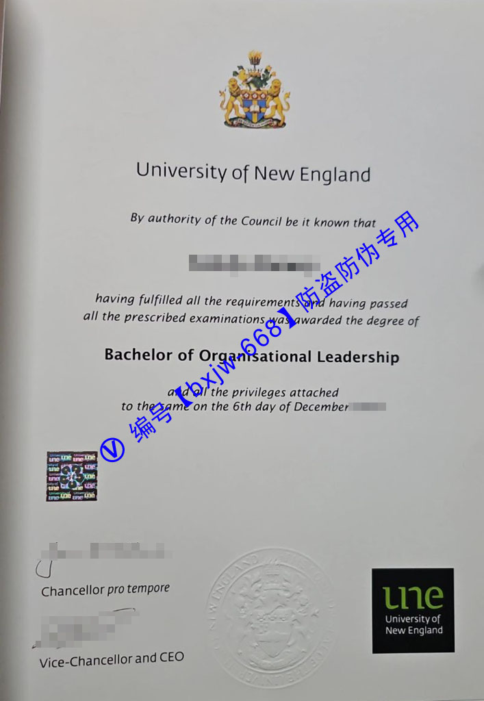

# 新英格兰大学毕业证样式模版（une diploma)视觉参照

在全球高等教育跨国流动与数字化转型的双重浪潮下，对海外高校学位证书的精准识别，已成为跨国企业人力资源部（HR）、学术审核机构以及广大归国留学生共同面临的刚需。作为澳大利亚历史悠久且享誉海内外的公立综合性大学，[新英格兰大学](https://une.edu.au "University of New England")（University of New England，简称 **UNE**）凭借其深厚的学术积淀与灵活的教育模式，每年都吸引着海量国际人才。

本文将以**新英格兰大学毕业证样式模版**为核心研究对象，结合最新的官方视觉系统规范，进行多维度的深度参照解析。通过解构其版面美学、符号寓意以及隐藏防伪链条，为您提供一份权威的“视觉密码手册”。

## 一、UNE 新英格兰大学学位证书的官方基础设计规范

[新英格兰大学](https://une.edu.au "University of New England")颁发的官方正式学位证书（在澳洲法律语境下通常被称为 **Testamur** ），不仅是学生数年寒窗苦读的最高荣誉证明，更是严格契合[澳大利亚学历资格框架](https://une.edu.austudy/international/programs-and-courses "Australian Qualifications Framework")（AQF）最高级别合规标准的严谨法律文本。

### 1. 物理形态与纸张质地
* **国际标准规格**：UNE 纸质毕业证书统一采用标准的 **A4 尺寸**（210mm × 297mm），版面为垂直纵向排版，布局疏密有致，完美适配行业主流的[防尘保护框](https://une.edu.aucurrent-students/graduation/graduation-services "UNE Graduation Memorabilia")。
* **特质纸张工艺**：证书母本选用高克重的**象牙浅克罗姆色（Ivory White）特种安全防伪纸张**。该纸张具有天然的高抗撕裂性与抗氧化防褪色性能。在自然光下，纸面呈现细腻的低反射哑光高级质感，触手可及之处能感受到明显的纤维沉淀。

## 二、UNE 毕业证模版核心视觉板块深度解析

透视最新的官方视觉参照样例，UNE 学位证书在传承英国传统学院派庄重感的同时，巧妙融合了现代主义的扁平化商业美学，主要由以下四大核心视觉板块构成：

### 1. 顶部：古典纹章学的集大成者——大学官方盾徽
证书最上方正中，是全版视觉含金量最高的元素——UNE 官方**全彩皇家彩绘盾徽（Coat of Arms）**。
* **皇冠与金狮**：盾徽顶部冠以一顶代表至高学术荣誉的金色皇冠，两侧由两只站立的金色圣约翰之狮托举，寓意学术的威严与力量的传承。
* **星海与书籍**：盾徽中心是一本翻开的典籍，背景点缀着象征南半球坐标的南十字星座。
* **下方校名**：盾徽正下方紧随两行标准英式罗马衬线体：
  > **University of New England**  
  > *By authority of the Council be it known that*（经校董会授权，特此公告）

### 2. 中部：极简主义的个人身份与学位信息
在流畅的英式花体引导词之下，是每位毕业生独一无二的个人变量信息链，采用现代高精度防扩散墨水打印：
* **毕业生姓名**：姓名采用加大号的标准现代无衬线黑体，确保高可读性与防伪修改。
* **学位名称板块**：用最醒目的字号居中打印所获学位（如商学学士、计算机科学硕士等）。字体的间距与结构比例经过严密的美学测算，维持整体版面的绝对视觉平衡。
* **法律权益宣告**：紧随其后的是 “*and all the privileges attached to the same*”（及附带之所有权益），并清晰标注授予的具体日期（例如：*10th day of February 2025*）。

### 3. 左下角：大学最高行政长官的亲笔签署
证书的左下方并列布局了两位最高决策者的官方签名：
* **议长签署**：上方为 **Chancellor**（校董会主席 / 议长）的亲笔签印及职务。
* **校长兼CEO签署**：下方为 **Vice-Chancellor and CEO**（校长兼首席执行官）的联名签署。签名的笔触细节、墨色深浅过渡自然，属于极其重要的肉眼防伪审查点。

### 4. 右下角：强烈的现代视觉符号——“黑底金字”现代标识
与顶部的古典盾徽形成鲜明呼应的是右下角的**现代品牌标识（Brand Logo）**：
* 采用一个高饱和度的**正方形曜石黑**作为底色底块。
* 内部反白印刷小写的流动感 “**une**” 字样，下方配以小字 “*University of New England*”。这一古典与现代碰撞的设计，是 UNE 官方证书在澳洲高校中独树一帜的标志性美学特征。

## 三、新英格兰大学纸质证书与数字化凭证的深度融合

作为澳洲远程教育与数字化校园的先驱，UNE 在坚持传统纸质证书精美工艺的同时，也走在了数字凭证验证的前沿。

### 1. 底部微缩法律信任背书（Digital Trust Line）
如果您仔细观察证书的最底端，会发现一行高精度微缩印刷的官方声明：
> *“This is a digital record of a testamur issued by The University of New England. The secure original document should be viewed directly on the My eQuals website...”*

这行字不仅是法律免责声明，更明确指出了该纸质证书是与 **My eQuals 全球官方区块链认证平台**实时绑定的实体映射。

### 2. 双轨制核验机制对照

| 物理验证维度（纸质 Testamur） | 数字化验证维度（My eQuals eDiploma） |
| :--- | :--- |
| **物理触感**：高克重防伪纸张的特有哑光质地与细腻纤维触感。 | **动态加密**：通过不可逆的密码学算法生成官方托管的加密 PDF 文件。 |
| **视觉防伪**：彩色立体皇家盾徽的细腻印刷层级、高层亲笔签名墨色。 | **电子签章**：包含符合国际标准的加密数字证书签名，任何篡改均会导致签章失效。 |
| **标志特征**：右下角极具辨识度的“黑底金字”无缝拼接现代方块 Logo。 | **永续核验**：支持通过官方安全链接，7x24小时面向全球合作企业或机构进行无缝真伪核验。 |

## 四、用人单位如何基于视觉参照快速辨别真伪？

对于企事业单位的HR而言，在面对新英格兰大学的入职学历材料时，可以遵循以下**“三步视觉审视法”**进行基础初审：

1. **审视顶部盾徽的清晰度与色彩层级**：正品证书顶部的皇家盾徽色彩饱满且边缘极其锐利，即使在放大镜下，皇冠齿轮与金狮毛发等细节也绝无重影、模糊或像素点扩散现象。
2. **核对黑白方块的边缘印刷**：右下角的曜石黑方块标志，其黑色墨底极为均匀、纯粹，与象牙白纸张的交界线平直如刀切，无任何油墨溢出或边缘发虚问题。
3. **签名与在任校长时效比对**：证书上签字的 Chancellor 和 Vice-Chancellor 姓名及花体字迹，必须与官方公示的对应毕业年份在任领导团队严格契合，时间线若出现交叉或错位，则存在重大伪造风险。

## 五、结语

**新英格兰大学毕业证样式模版**不仅是广大 UNE 学子多年学术长跑的完美终点线，更是一件融合了英国传统纹章美学与当代澳大利亚先锋数字技术的艺术品。通过本文全方位的视觉参照与技术拆解，相信无论是留学生群体还是专业评审机构，都能对这份高含金量凭证建立起清晰、立体的认知体系。
晰、可靠的视觉与逻辑依据。

